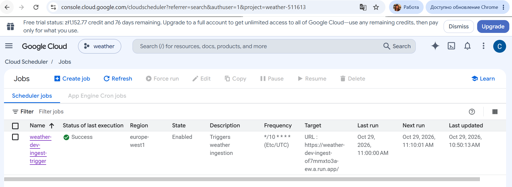
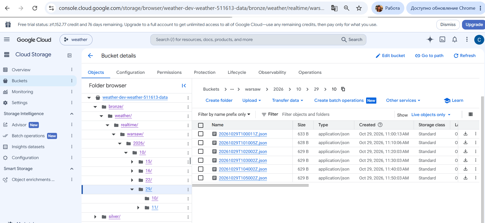
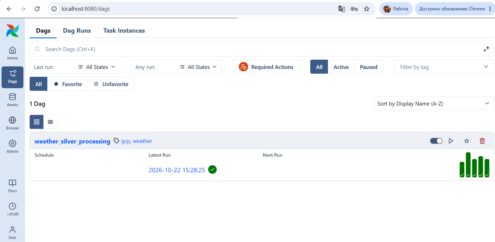
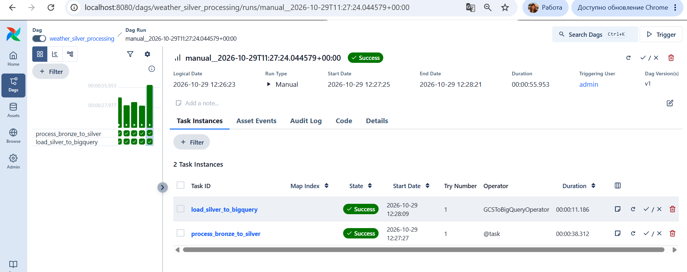
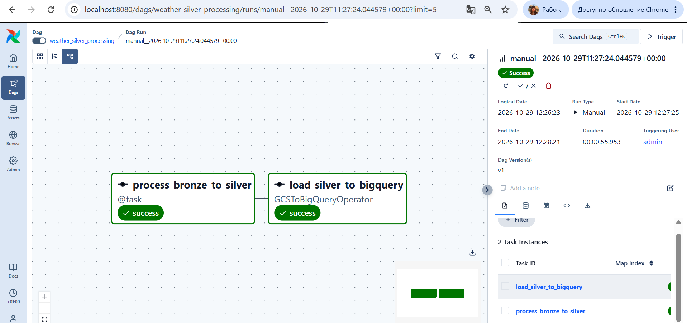
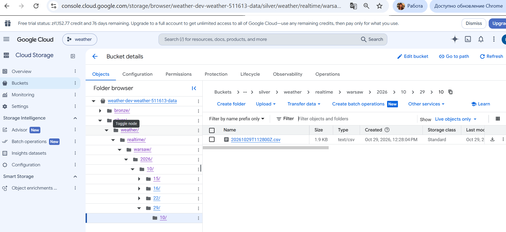
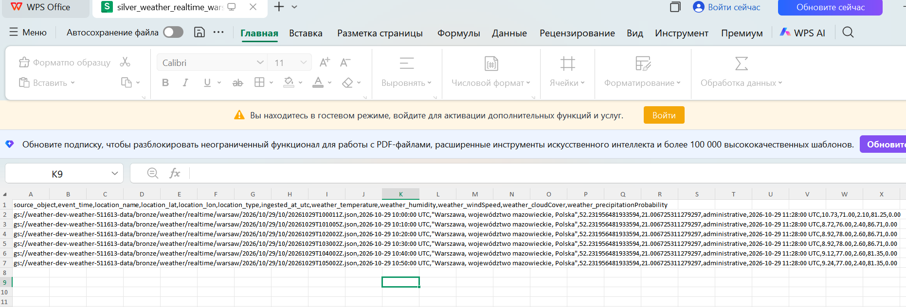
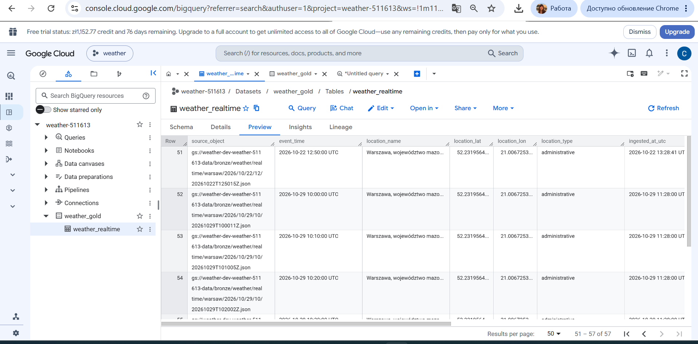
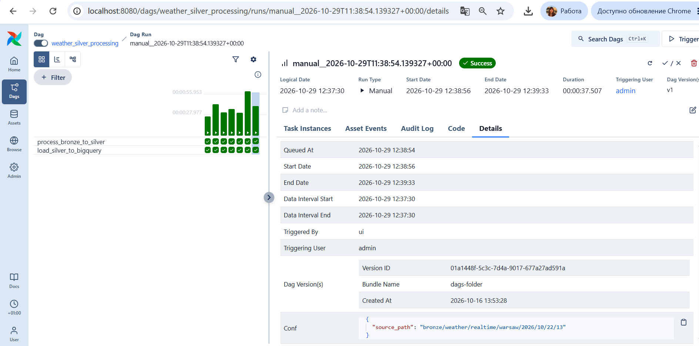

## GSC job runs successfully

## bucket(s) was created and data is uploaded

## Airflow DAG is shown up correctly

##  DAG runs successfully

##  DAG graph

##  data appeared successfully in the silver layer

## file with silver layer data

## data appears in the golden layer in Bigquerry too

Those was an example with a mannual trigger without source path for one city. It also works for one city with the source input (here i provided it for some data i retrieved before). You can see it's a success (the source path is provided as demonstrated at the bottom in confs)

